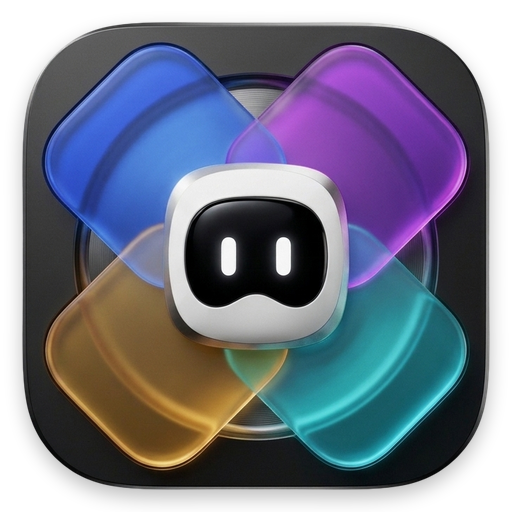

<div align="center">

**English** · [简体中文](docs/readme/README_zh.md) · [繁體中文](docs/readme/README_zh-TW.md) · [日本語](docs/readme/README_ja.md) · [한국어](docs/readme/README_ko.md) · [Español](docs/readme/README_es.md) · [Français](docs/readme/README_fr.md) · [Deutsch](docs/readme/README_de.md) · [Português (Brasil)](docs/readme/README_pt-BR.md) · [Русский](docs/readme/README_ru.md) · [Italiano](docs/readme/README_it.md) · [Tiếng Việt](docs/readme/README_vi.md) · [Türkçe](docs/readme/README_tr.md) · [العربية](docs/readme/README_ar.md) · [Bahasa Indonesia](docs/readme/README_id.md) · [हिन्दी](docs/readme/README_hi.md)

<br />



# BotHub

### **All your personal AI agents in one native desktop workspace**

**Run Grok Bot, ChatGPT Dot, Meta Muse, and Hark side by side on macOS & Windows — with multi-account isolation, automatic multi-bot sidebar sync, and a Grok-style right-side workbench.**

[](https://github.com/qybaihe/bothub/releases/latest)
[](https://github.com/qybaihe/bothub/releases/latest)
[](https://github.com/qybaihe/bothub/releases/latest)
[](https://github.com/qybaihe/bothub/actions/workflows/ci.yml)
[](LICENSE)

<br />

**[🍎 Download for Mac (Apple Silicon)](https://github.com/qybaihe/bothub/releases/latest) · [💻 Download for Mac (Intel)](https://github.com/qybaihe/bothub/releases/latest) · [🪟 Download for Windows](https://github.com/qybaihe/bothub/releases/latest) · [💬 Discussions](https://github.com/qybaihe/bothub/discussions)**

[Why BotHub](#-why-bothub) · [30-Second Quick Start](#-30-second-quick-start) · [Supported Platforms](#-supported-platforms) · [Everyday Workflows](#-everyday-workflows) · [Development](#-development) · [FAQ](#-faq)

</div>

---

<div align="center">
<picture>
  <source media="(prefers-color-scheme: dark)" srcset="docs/assets/bothub-dark.webp">
  
</picture>
</div>

<br />

## 💡 Why BotHub?

If you rely on personal AI agents every day, your desktop quickly turns into four separate apps and a dozen incognito browser profiles. **BotHub replaces the clutter with one calm, fast native window:**

<table>
<tr>
<td width="33%" valign="top">

### 🗂️ Bot-first left sidebar
Organize **Grok Bot**, **ChatGPT Dot**, **Meta Muse**, and **Hark** into custom project groups. Sign into **one Grok Bot account** and every bot on that account automatically expands into the sidebar — ready to switch in one click or via `⌘K`.

</td>
<td width="33%" valign="top">

### 👥 Multi-account without friction
Keep work, personal, and team accounts online at the same time without ever mixing sessions. Sign in via window, 1-click default browser auth, token/cookie paste, batch email import, and 1-to-1 proxy pool binding.

</td>
<td width="33%" valign="top">

### 🛠️ Right-side workbench (`⌘I`)
Keep the center conversation clean. Open the right-hand workbench whenever you need to inspect subagent tasks, edit memories & skills, manage scheduled jobs, browse generated files, or control cloud sandboxes.

</td>
</tr>
</table>

---

## ⚡ 30-Second Quick Start

### 1. Download & Install

Grab the installer for your machine from [**Releases**](https://github.com/qybaihe/bothub/releases/latest):

| Platform | Installer | Notes |
| :--- | :--- | :--- |
| **macOS (Apple Silicon M1–M4)** | `BotHub-<version>-arm64.dmg` | **Apple Developer ID signed & notarized** — drag into `Applications` and open directly |
| **macOS (Intel)** | `BotHub-<version>-x64.dmg` | **Apple Developer ID signed & notarized** — opens directly without Gatekeeper warnings |
| **Windows 10 / 11 (x64)** | `BotHub-Setup-<version>-x64.exe` | One-click NSIS installer with automatic background updates |

### 2. Connect Your Accounts (Two Easy Entry Points)

- **Top-left `+` button (`⌘N`)**: Pick a platform to sign in via window, authorize in your default browser, or paste credentials directly.
- **Bottom-left `Settings & Accounts`**: Manage all connected accounts in one dashboard, batch-import Muse or Dot accounts, sync all bots under a Grok account, and configure your proxy pool.

> 💡 **Built-in Full-Screen Guide**: Click the **✦ Sparkles** icon at the bottom-left of the sidebar anytime for an interactive walkthrough of the layout, account import paths, and right-side workbench.

### 3. Chat & Control

Click any bot on the left to stream replies, attach files, or approve actions. Press **`⌘I`** (`Ctrl+I` on Windows) or click the top-right panel icon to toggle that bot's tailored right-side workbench.

---

## 🤖 Supported Platforms

Each platform adapts the right-side workbench to its real capabilities — no generic filler panels:

| Platform | How You Sign In / Import | How It Appears in Sidebar | Right-Side Workbench (`⌘I`) |
| :--- | :--- | :--- | :--- |
| **Grok Bot** (`grok.com`) | Clean sign-in window, **1-click default browser auth**, or Token / Cookie / JSON / API Key paste | **1 account → many bots**: all agents & group rooms on your account sync automatically as individual sidebar bots; create new bots without re-authenticating | Sessions, live subagent tasks, automations, memories & skills, generated files, cloud sandbox, MCP connectors & recipe import/export |
| **Meta Muse** (`muse.ai`) | Partition sign-in window or **batch email OTP import** | 1 bot per isolated Muse account (supports 10+ parallel accounts) | Usage quota, action approvals, session history, cron schedules, goals, memories, skills, workspace file preview & cloud computer view |
| **ChatGPT Dot** (`chatgpt.com/dots`) | Web sign-in window or **single / multi-line AT, RT & JSON batch import** | 1 bot per Dot account with automatic Refresh Token renewal | Orbit persona switcher, Dot vs. Native mode, core goal editor, **1-click cross-account memory migration**, and Pages / Library browser |
| **Hark** (`hark.com`) | Google / email sign-in window or **Session Cookie / Token paste** | 1 bot per Hark account | Home workflow cards, conversation switcher, scheduled tasks, generated file library, live cloud browser view & workspace connectors |

---

## ✨ Everyday Workflows

- **Create & clone Grok Bots in seconds**: Already signed into Grok Bot? Click `+` → **Grok Bot** to spin up a new specialized bot on your existing account or re-sync your full roster in one click.
- **1-to-1 Proxy Pool for multi-account fleets**: Paste a list of `SOCKS5` / `SOCKS5H` / `HTTP` proxies in **Settings → Proxy Pool** and bind one dedicated egress IP per account. If a proxy fails, BotHub blocks traffic rather than leaking your direct IP.
- **Never double-sends a message**: Every turn tracks *sending*, *accepted · replying*, *no reply*, or *failed*. Once a platform accepts your prompt, BotHub never mislabels it as unsent.
- **Living interactive avatars**: Every bot features a customizable 3D `GrokBotMark` character that tracks your cursor and animates as it thinks, works, or streams — or upload your own custom avatar.
- **One-click updates on macOS & Windows**: Signed builds download new releases in the background and update in a single click.
- **100% local & telemetry-free**: BotHub is an independent open-source client (not affiliated with xAI, OpenAI, Meta, or Hark). Your accounts, cookies, and Keychain-protected tokens never leave your computer.

---

## ⌨️ Useful Shortcuts

| Shortcut (macOS / Windows) | Action |
| :--- | :--- |
| `⌘K` / `Ctrl+K` | Command Palette — instant search across bots, groups, and actions |
| `⌘N` / `Ctrl+N` | Add a new bot or connect an account |
| `⌘I` / `Ctrl+I` | Toggle the right-side workbench for the active bot |
| `⌘[` · `⌘]` / `Ctrl+[` · `Ctrl+]` | Jump to the previous / next bot in the sidebar |

---

## 🧰 Development

Requires **Node.js 22.19+** (Node 24 recommended; see [`.nvmrc`](.nvmrc)).

```bash
git clone https://github.com/qybaihe/bothub.git
cd bothub
npm ci
npm run dev          # Launch Electron + Vite with hot reload
```

| Command | Description |
| :--- | :--- |
| `npm run dev` | Start Electron main, preload, and React renderer with hot reload |
| `npm run typecheck` | Type-check both Node and renderer TypeScript targets |
| `npm test` | Run the Vitest unit test suite |
| `npm run build` | Build production bundles into `out/` |
| `npm run dist:dir` | Package an unpacked macOS `arm64` app in `release/` for quick local testing |
| `npm run dist:mac` / `npm run dist:win` | Build distributable macOS `.dmg` + `.zip` or Windows `.exe` installers |

Want to contribute or add a new agent platform? Read [**CONTRIBUTING.md**](CONTRIBUTING.md) and explore the wire-protocol notes in [**`docs/`**](docs/README.md).

---

## ❓ FAQ

<details>
<summary><b>Is BotHub affiliated with xAI, OpenAI, Meta, or Hark?</b></summary>

No. BotHub is an independent, MIT-licensed desktop client. You sign in with your own accounts, and BotHub talks directly to each platform from your machine.

</details>

<details>
<summary><b>Do I get Gatekeeper warnings on macOS?</b></summary>

No — official macOS `.dmg` releases (`v0.5.0+`) are signed with an **Apple Developer ID** certificate and **notarized by Apple**. Just drag `BotHub.app` to `Applications` and launch it normally.

</details>

<details>
<summary><b>How does Grok Bot multi-bot sync work?</b></summary>

In Grok Bot, one user account owns multiple specialized bots and group rooms. As soon as you sign into or import a Grok account in BotHub, all bots on that account appear individually in your left sidebar. Removing one bot locally hides it without signing out your other bots, and clicking **Sync All Bots** restores the full list anytime.

</details>

<details>
<summary><b>Where are my sessions and tokens stored?</b></summary>

Exclusively on your device (`~/Library/Application Support/bothub` on macOS, `%APPDATA%\bothub` on Windows), protected by your OS Keychain / DPAPI (`safeStorage`). BotHub collects zero analytics or telemetry.

</details>

---

## 📄 License

Released under the [MIT License](LICENSE). If BotHub saves you from tab overload, a **⭐ Star** on GitHub helps more agent builders discover it!
