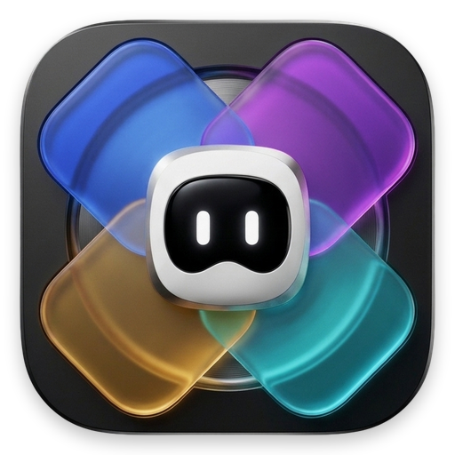
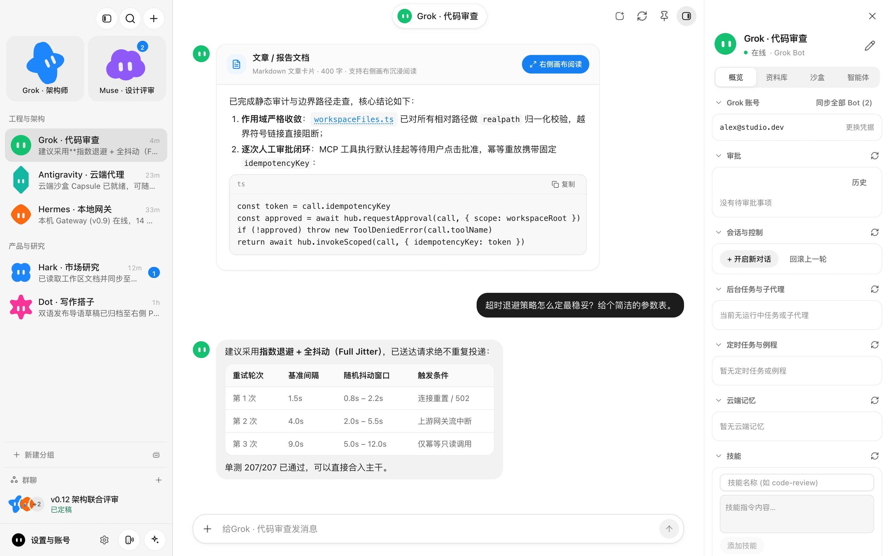

<div align="center">



# BotArk

### **Tập hợp mọi agent cá nhân của bạn và dùng chúng trong một ứng dụng duy nhất, giống như Grok Bot**

**Ứng dụng cho macOS và Windows gom các bot Meta Muse, Grok Bot, Hark và Dot của bạn vào một cửa sổ, mỗi bot đăng nhập bằng một tài khoản riêng, tách biệt.**

[](https://github.com/qybaihe/botark/releases/latest)
[](https://github.com/qybaihe/botark/actions/workflows/ci.yml)
[](#-bắt-đầu-nhanh)
[](https://www.electronjs.org/)
[](../../LICENSE)

**[⬇️ Tải cho macOS](https://github.com/qybaihe/botark/releases/latest) · [⬇️ Tải cho Windows](https://github.com/qybaihe/botark/releases/latest) · [📦 Tất cả phiên bản](https://github.com/qybaihe/botark/releases) · [🐛 Báo lỗi](https://github.com/qybaihe/botark/issues)**

[Bắt đầu nhanh](#-bắt-đầu-nhanh) · [Nền tảng](#-nền-tảng-được-hỗ-trợ) · [Tính năng](#-tính-năng) · [Phát triển](#-phát-triển) · [Phát hành](#-phát-hành) · [Giao thức](#-tài-liệu-giao-thức) · [Câu hỏi thường gặp](#-câu-hỏi-thường-gặp)

<sub>[English](../../README.md) · [简体中文](README_zh.md) · [繁體中文](README_zh-TW.md) · [日本語](README_ja.md) · [한국어](README_ko.md) · [Español](README_es.md) · [Français](README_fr.md) · [Deutsch](README_de.md) · [Português (Brasil)](README_pt-BR.md) · [Русский](README_ru.md) · [Italiano](README_it.md) · **Tiếng Việt** · [Türkçe](README_tr.md) · [العربية](README_ar.md) · [Bahasa Indonesia](README_id.md) · [हिन्दी](README_hi.md)</sub>

</div>

---

> [!NOTE]
> BotArk là ứng dụng độc lập, không liên kết với Meta, xAI, Hark hay OpenAI. Bạn đăng nhập bằng tài khoản của chính mình và thông tin đăng nhập chỉ lưu trên máy tính của bạn.

<div align="center">
<picture>
  <source media="(prefers-color-scheme: dark)" srcset="../assets/botark-dark.webp">
  
</picture>
<sub>Ảnh chụp màn hình với dữ liệu mẫu hư cấu.</sub>
</div>

<br />

<table>
<tr>
<td width="33%" valign="top">

### 🧩 Mọi agent, một cửa sổ
Các bot Muse, Grok Bot, Hark và Dot nằm cạnh nhau, được nhóm ở thanh bên; mỗi bot có cuộc trò chuyện, bảng chi tiết và cài đặt riêng.

</td>
<td width="33%" valign="top">

### 🔐 Tài khoản tách biệt
Mỗi tài khoản chạy trong phân vùng phiên riêng hoặc ô lưu thông tin đăng nhập được mã hóa, nên nhiều tài khoản trên cùng một nền tảng không bao giờ lẫn vào nhau.

</td>
<td width="33%" valign="top">

### ✅ Gửi tin đáng tin cậy
Tin nhắn hiển thị *đang gửi*, *đã gửi tới · đang trả lời*, *không có phản hồi* hoặc *thất bại*. Tin nhắn mà nền tảng đã nhận sẽ không bao giờ bị coi là chưa gửi, nên thử lại không làm tin nhắn bị gửi hai lần.

</td>
</tr>
</table>

---

## ⚡ Bắt đầu nhanh

Tải tệp phù hợp với hệ điều hành của bạn từ [phiên bản mới nhất](https://github.com/qybaihe/botark/releases/latest):

| Hệ điều hành | Tệp |
| :--- | :--- |
| macOS, Apple silicon | `BotArk-<phiên bản>-arm64.dmg` |
| macOS, Intel | `BotArk-<phiên bản>-x64.dmg` |
| Windows 10/11 (x64) | `BotArk-Setup-<phiên bản>-x64.exe` |

> [!TIP]
> **Bản macOS đã được ký số và công chứng (Notarized) bởi Apple Developer ID.** Chỉ cần kéo `BotArk.app` vào `Applications` và mở trực tiếp.

Sau đó bấm **+** ở thanh bên, chọn nền tảng và đăng nhập. Mỗi bot giữ tài khoản riêng của mình.

**Cập nhật**: trên Windows, BotArk tải phiên bản mới ở chế độ nền và cài đặt chỉ với một cú nhấp. Trên macOS, ứng dụng báo khi có phiên bản mới và mở trang tải xuống.

## 🤖 Nền tảng được hỗ trợ

| Nền tảng | Giao thức và truyền tải | Bạn nhận được gì |
| :--- | :--- | :--- |
| **Meta Muse** (`muse.ai`) | Phân vùng Electron tách biệt + cổng WebSocket gốc | Nhiều tài khoản, nhập hàng loạt bằng mã qua email, proxy HTTP/SOCKS5 cho từng tài khoản, máy tính đám mây, mục tiêu, peer, tệp không gian làm việc, phê duyệt connector và chẩn đoán |
| **Grok Bot** (`grok.com`) | Connect-RPC / Protobuf qua cổng Sand (`*.sand.x.ai`) | Nhiều tài khoản, không gian làm việc đám mây Sand, phát trực tiếp, lịch sử gọi công cụ, phiên, tác vụ theo lịch, bộ nhớ và kỹ năng |
| **Hark** (`hark.com`) | WebSocket RPC + REST đa phương thức | Đăng nhập qua trình duyệt (Google hoặc email), phát trực tiếp kèm đồng bộ phản hồi ở chế độ nền, đính kèm tệp và hình ảnh, thẻ tài liệu, tác vụ theo lịch, bộ nhớ và connector |
| **Dot** (`chatgpt.com/dots`) | REST OpenAI Orbit/TBO + sự kiện do máy chủ gửi (SSE) | Đăng nhập OAuth qua trình duyệt hoặc nhập Access/Refresh Token, lưu token được mã hóa, phát trực tiếp, tải tệp lên, kỹ năng, tự động hóa, connector và proxy cho từng tài khoản |
| **Hermes** (`NousResearch/hermes-agent`) | Open-Source Gateway REST + Native Session SSE | Tự động phát hiện `~/.hermes`, kết nối máy chủ từ xa (mã hóa Keychain), streaming SSE & công cụ, phê duyệt lệnh, chuyển phiên, Cron, Skills & Toolsets |

## ✨ Tính năng

- **Nhiều tài khoản, không lẫn lộn**: mỗi tài khoản nằm trong phân vùng Electron `persist:` riêng hoặc ô lưu thông tin đăng nhập được mã hóa, nên bạn có thể dùng nhiều tài khoản của cùng một nền tảng cùng lúc.
- **Bảng điều khiển quản lý**: một màn hình toàn cảnh với tổng quan, lọc và tìm kiếm bot, kiểm tra kết nối hàng loạt cùng quản lý tài khoản, token và proxy cho từng nền tảng.
- **Trò chuyện với agent đầy đủ**: phát trực tiếp kèm quá trình suy nghĩ và thẻ công cụ, khôi phục tác vụ nền chạy lâu, bảng Markdown, tô sáng mã, xem trước tài liệu và tải tệp đính kèm.
- **Bảng chi tiết bot**: bảng bên phải hiển thị phiên, tác vụ theo lịch, bộ nhớ, kỹ năng, tệp và thành viên của từng bot, tùy theo nền tảng.
- **Ảnh đại diện sống động**: mỗi bot có một nhân vật hoạt hình `GrokBotMark` dõi theo con trỏ và phản ứng khi đang làm việc; bạn có thể chọn hình dạng, màu sắc hoặc tải ảnh lên.
- **An toàn ngay từ đầu**: token và mật khẩu proxy được mã hóa bằng `safeStorage` của Electron (Keychain trên macOS) và lưu với quyền `0600`. Không có bí mật viết cứng trong mã, không có dữ liệu đo lường.
- **Giao diện tiếng Anh và tiếng Trung**, giao diện sáng và tối.

## 🧰 Phát triển

```bash
npm ci
npm run dev          # Electron + Vite với tải lại nóng
```

| Lệnh | Mô tả |
| :--- | :--- |
| `npm run dev` | Chạy tiến trình chính Electron, preload và giao diện React với tải lại nóng |
| `npm run dev:web` | Chỉ chạy giao diện trong trình duyệt (không Electron, không tài khoản) |
| `npm run typecheck` | Kiểm tra kiểu cho Node và web |
| `npm test` | Kiểm thử đơn vị (Vitest) |
| `npm run build` | Kiểm tra kiểu và dựng bản production vào `out/` |
| `npm run dist:mac` / `npm run dist:win` | Đóng gói macOS `dmg` + `zip` (arm64 + x64) / trình cài đặt NSIS cho Windows vào `release/` |
| `npm run dist:dir` | Ứng dụng macOS arm64 chưa đóng gói để thử nhanh |

Ảnh chụp màn hình trong README được tạo từ dữ liệu hư cấu: `npx -y -p playwright@1.64 node scripts/screenshot/capture.mjs [--dark]`.

## 🚀 Phát hành

Mỗi lần push, CI ([`ci.yml`](../../.github/workflows/ci.yml)) kiểm tra kiểu, chạy kiểm thử, dựng và đóng gói trên macOS và Windows.

1. Tăng `version` trong `package.json` và merge vào `main`.
2. Push một tag `vX.Y.Z` khớp với phiên bản.
3. [`release.yml`](../../.github/workflows/release.yml) tạo bản phát hành nháp, dựng macOS (arm64 + x64 `dmg`/`zip`, `latest-mac.yml`) và Windows (NSIS `exe`, `latest.yml`), tải lên tất cả và công bố bản phát hành khi đã đủ tệp.

Mặc định các bản dựng không được ký. Việc ký và công chứng sẽ bật khi các secret sau của kho được thiết lập: `CSC_LINK`, `CSC_KEY_PASSWORD`, `APPLE_ID`, `APPLE_APP_SPECIFIC_PASSWORD`, `APPLE_TEAM_ID` (macOS) hoặc `WIN_CSC_LINK`, `WIN_CSC_KEY_PASSWORD` (Windows).

## 📁 Cấu trúc dự án

```text
src/
  adapters/        Bộ điều hợp nền tảng (Meta Muse, Grok Bot, Hark, Dot) và giao diện chung PlatformAdapter
  main/            Tiến trình chính Electron
    muse/          Phiên phân vùng Muse, đăng nhập hàng loạt và định tuyến proxy theo tài khoản
    muse-native/   Client cổng WebSocket gốc cho máy tính đám mây và không gian làm việc Muse
    grok/          Xác thực Sand, client Connect-RPC và trình xử lý IPC cho Grok Bot
    hark/          Client WebSocket/REST, tải tệp đính kèm và trình xử lý IPC cho Hark
    dot/           Client OpenAI Dot (Orbit/TBO), kho token mã hóa, phát trực tiếp SSE và IPC
  preload/         API contextBridge có kiểu, cung cấp dưới dạng window.electron
  shared/          Quy ước kênh IPC và kiểu dùng chung giữa tiến trình chính và giao diện
  renderer/        Giao diện máy tính bằng React + Tailwind + Zustand
    components/    Thanh bên, trò chuyện, bảng chi tiết, bảng theo nền tảng, bảng điều khiển quản lý, GrokBotMark
    store/         Trạng thái bot, hợp nhất tin nhắn phát trực tiếp và lưu trữ cục bộ
scripts/screenshot/  Ảnh chụp README từ dữ liệu mẫu hư cấu
```

## 📚 Tài liệu giao thức

Giao thức và ghi chú API của từng nền tảng nằm trong [`docs/`](../README.md):

- **OpenAI Dot** (`chatgpt.com/dots`): [`docs/dot/protocol.md`](../dot/protocol.md): xác thực OAuth PKCE và phiên web, hồ sơ Orbit, SSE và REST cho phòng, WebSocket JSON-RPC 2.0, Pages, Thư viện và di chuyển bộ nhớ
- **Meta Muse** (`muse.ai`): [`docs/museai/protocol.md`](../museai/protocol.md): bắt tay WebSocket `Noise_XX_25519_ChaChaPoly_SHA256` và hơn 65 phương thức JSON-RPC
- **xAI Grok Bot** (`grok.com`): [`docs/grokbot-protocol/protocol.md`](../grokbot-protocol/protocol.md): lệnh gọi Connect-RPC đơn và phát trực tiếp qua HTTP/2, xác thực Sand, kỹ năng, bộ nhớ, tự động hóa và sandbox đám mây
- **Hark** (`hark.com`): [`docs/hark/protocol.md`](../hark/protocol.md): endpoint REST và phát trực tiếp NDJSON, connector, tác vụ theo lịch, cây tệp của VM và phiên máy tính

## ❓ Câu hỏi thường gặp

<details>
<summary><b>Tin nhắn hiện "đã gửi tới · đang trả lời" rất lâu. Thử lại có gửi hai lần không?</b></summary>

Không. Khi nền tảng đã nhận tin nhắn, BotArk không bao giờ coi nó là chưa gửi. Nếu không có phản hồi, ứng dụng hiển thị *không có phản hồi* kèm nút **Gửi lại**, nói rõ rằng sẽ gửi thêm một bản nữa.

</details>

<details>
<summary><b>Mỗi tài khoản có thể dùng proxy riêng không?</b></summary>

Có, với tài khoản Muse và Dot (HTTP hoặc SOCKS5). Nếu không áp dụng được proxy, BotArk sẽ chặn lưu lượng của tài khoản đó thay vì chuyển sang kết nối trực tiếp.

</details>

## 📄 Giấy phép

Phát hành theo [Giấy phép MIT](../../LICENSE).

---

## 📈 Star History

<div align="center">
  <a href="https://star-history.com/#qybaihe/botark&Date">
    <picture>
      <source media="(prefers-color-scheme: dark)" srcset="https://api.star-history.com/svg?repos=qybaihe/botark&type=Date&theme=dark" />
      
    </picture>
  </a>
</div>
