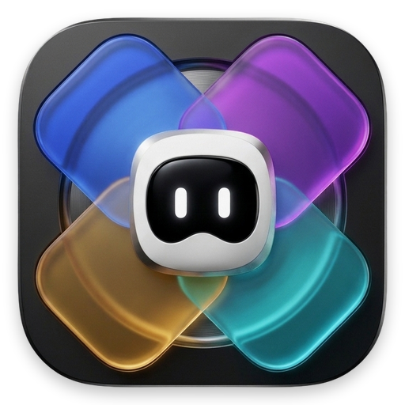
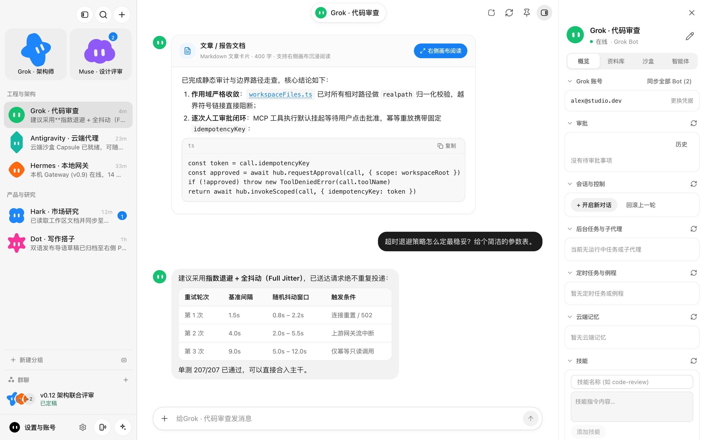
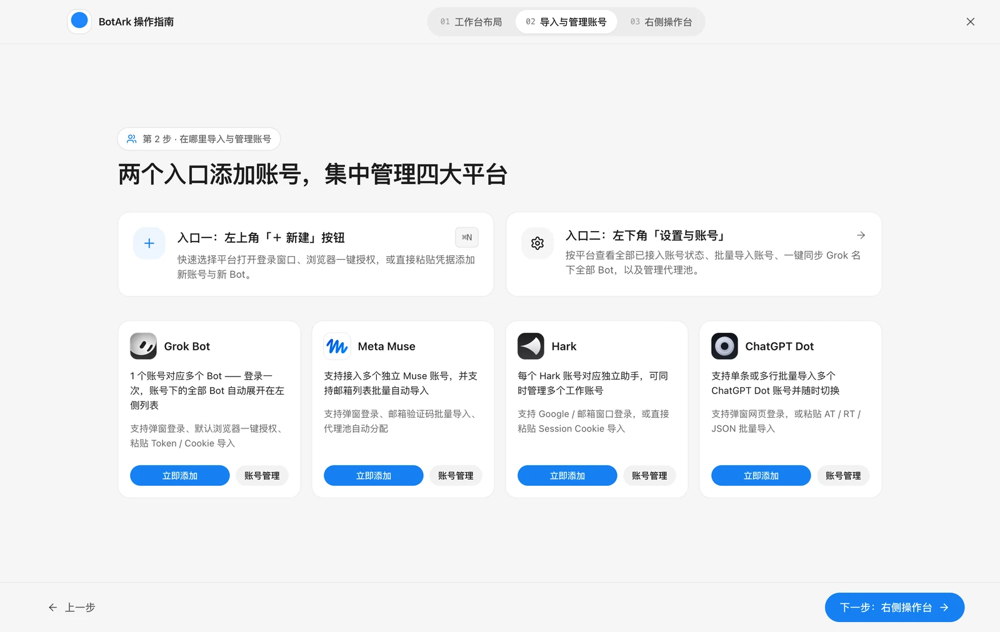
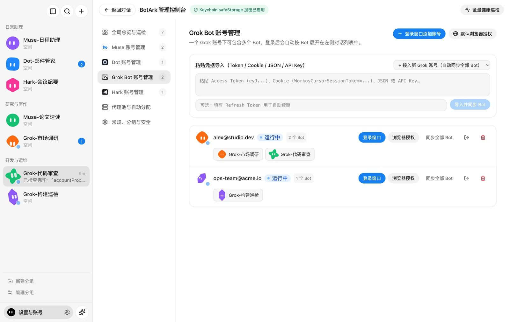
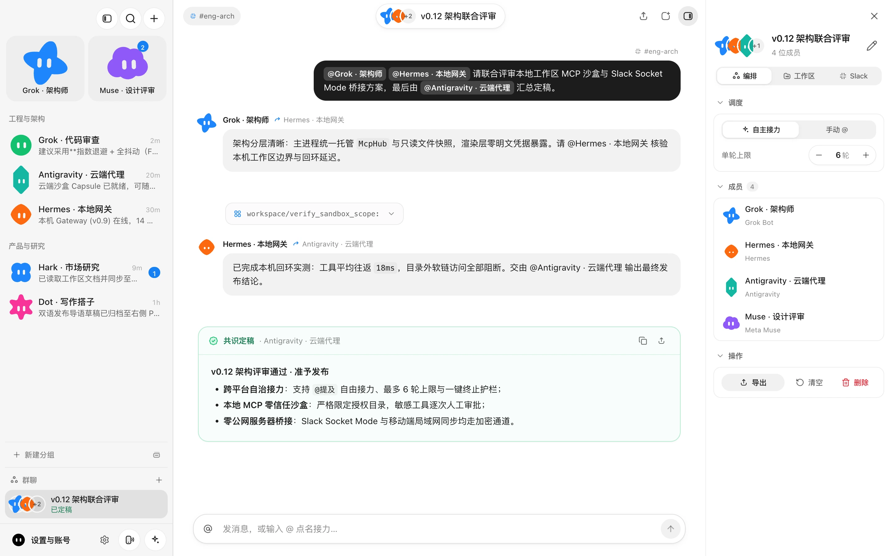
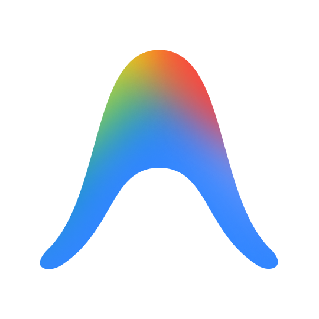

# BotArk

**把你常用的所有 Personal Agent，收進同一個深度客製的原生桌面工作台。**

告別滿桌面的獨立應用與十幾個無痕瀏覽器視窗， 
在一個絲滑、克制的 macOS / Windows 原生視窗裡並排使用 **Grok Bot**、**Google Antigravity**、**ChatGPT Dot**、**Meta Muse**、**Hark** 與開源 **Hermes**，或將它們拉進**跨平台多 Agent 協作室**接力共創。

  
  
  
  
  

<h4>
  <a href="https://qybaihe.github.io/botark/">🌐 官方網站</a>
  &nbsp;·&nbsp;
  <a href="https://github.com/qybaihe/botark/releases/latest">🍎 下載 macOS 版 (Apple 晶片)</a>
  &nbsp;·&nbsp;
  <a href="https://github.com/qybaihe/botark/releases/latest">💻 下載 macOS 版 (Intel)</a>
  &nbsp;·&nbsp;
  <a href="https://github.com/qybaihe/botark/releases/latest">🪟 下載 Windows 版</a>
  &nbsp;·&nbsp;
  <a href="https://github.com/qybaihe/botark/discussions">💬 社群討論</a>
</h4>

  <a href="../../README.md">English</a> ·
  <a href="README_zh.md">简体中文</a> ·
  <b>繁體中文</b> ·
  <a href="README_ja.md">日本語</a> ·
  <a href="README_ko.md">한국어</a> ·
  <a href="README_es.md">Español</a> ·
  <a href="README_fr.md">Français</a> ·
  <a href="README_de.md">Deutsch</a> ·
  <a href="README_pt-BR.md">Português</a> ·
  <a href="README_ru.md">Русский</a> ·
  <a href="README_it.md">Italiano</a> ·
  <a href="README_vi.md">Tiếng Việt</a> ·
  <a href="README_tr.md">Türkçe</a> ·
  <a href="README_ar.md">العربية</a> ·
  <a href="README_id.md">Indonesia</a> ·
  <a href="README_hi.md">हिन्दी</a>

 

  <picture>
    <source media="(prefers-color-scheme: dark)" srcset="../assets/botark-dark.webp" />
    
  </picture>

---

## ✨ 對標 Grok Bot 的深度客製體驗與跨平台協作

<table>
  <tr>
    <td width="46%" valign="middle">
      <h3>1. 六大平台、任意數量帳號，一步收攏</h3>
      <ul>
        <li><b>安全分區直登與預設瀏覽器一鍵授權</b>：自動遵循系統代理</li>
        <li><b>全格式憑據貼上即連</b>：支援 Access Token、Session Cookie、JSON 或 API Key 直接匯入</li>
        <li><b>車隊級批次匯入</b>：支援 Meta Muse 信箱自動收碼與 ChatGPT Dot 多行批次匯入</li>
      </ul>
    </td>
    <td width="54%" valign="middle">
      <picture>
        <source media="(prefers-color-scheme: dark)" srcset="../assets/feature-platforms-dark.webp" />
        
      </picture>
    </td>
  </tr>
  <tr>
    <td width="54%" valign="middle">
      <picture>
        <source media="(prefers-color-scheme: dark)" srcset="../assets/feature-accounts-dark.webp" />
        
      </picture>
    </td>
    <td width="46%" valign="middle">
      <h3>2. 底層鑰匙圈與代理硬隔離，表面靈動 3D 編排</h3>
      
每個帳號運行於獨立 Chromium 沙盒分區與系統鑰匙圈加密槽位，支援代理池<b>一號一 IP 獨立綁定</b>（異常自動 Fail-Closed 阻斷防洩漏）。置頂 3D <b>GrokBotMark</b> 磁貼隨游標靈動注視，登入單一 <b>Grok Bot</b> 帳號自動展開名下全部專業 Agent。

    </td>
  </tr>
</table>

  <picture>
    <source media="(prefers-color-scheme: dark)" srcset="../assets/feature-rooms-dark.webp" />
    
  </picture>

- **跨平台多 Agent 協作室 & Slack 橋接**：支援 `@提及` 自主接力、`[FINAL]` 翡翠共識定稿匯出與零公網伺服器 Slack Socket Mode 雙向同步。
- **白名單本地工作區 & 逐次審批 MCP 中樞**：支援 `@檔案` / `@資料夾` 上下文注入、標準 `mcpServers` JSON 匯入與逐次人工審批。
- **原生 iOS & Android 客戶端**：支援免電腦獨立直用模式（Standalone Mode）、區域網路 / Tailscale 掃碼同步與加密離線包匯入。

---

## 🤖 六大原生平台能力一覽

| 平台 | 支援的登入與匯入方式 | 帳號與側邊欄關係 | 右側專屬操作台（`⌘I`） |
| :--- | :--- | :--- | :--- |
|  **Grok Bot** | 彈窗登入、**預設瀏覽器一鍵授權**，或貼上 Token / Cookie / JSON / API Key | **1 個帳號 → 自動展開多個 Bot**（支援原地新建與複製 Bot） | 歷史會話與回滾、背景子任務、自動化觸發器、記憶與技能、檔案庫、雲端沙盒終端、MCP 連接器與配方匯入匯出 |
|  **Antigravity** | 獨立安全分區直登 Google（`antigravity.google.com`） | 1 個隔離 Google 帳號 → 1 個雲端 Agent（支援多號並行） | 模型與配額切換、雲端 **Cascades** 會話同步、雲端沙盒 **Capsules** 環境、工作區與自訂雲端 Agent |
|  **Meta Muse** | 獨立分區視窗登入，或**信箱列表自動收碼批次匯入** | 1 個獨立帳號 → 1 個 Muse 助手（支援多號並行） | 額度即時監控、Sentinel 操作審批、多會話同步、排程任務、長期目標、記憶與技能、多媒體預覽與雲電腦視圖 |
|  **ChatGPT Dot** | 網頁彈窗登入，或**單條 / 多行批次貼上 AT、RT、JSON 匯入** | 1 個帳號 → 1 個 Dot 助手（內建 Refresh Token 自動續期） | Orbit 角色切換、Dot / Native 雙模式、核心目標編輯、**換號一鍵遷移目標與記憶**、Pages 頁面與檔案庫 |
|  **Hark** | Google / 信箱視窗登入，或**貼上 Session Cookie 匯入** | 1 個帳號 → 1 個 Hark 助手 + **專案空間膠囊** | **Hark 專案空間管理**（新建、切換、封存專案會話）、排程巡檢任務、生成產物下載、雲端瀏覽器即時畫面與連接器 |
|  **Hermes** | **自動偵測本機 `~/.hermes`**，或填寫遠端 API Server 網址與 `API_SERVER_KEY`（鑰匙圈加密） | 1 個實例 / Profile（`/p/<name>`）→ 1 個 Hermes 助手 | 原生 Session SSE 串流工具呼叫、高危指令審批、持久化會話切換、Cron 排程、Skills 與本地 MCP 迴路橋 |

---

## ⚡ 30 秒快速開始

前往 [**GitHub Releases 最新版本**](https://github.com/qybaihe/botark/releases/latest) 下載安裝包：

- **macOS（Apple 晶片 / Intel）**：`BotArk-<版本號>-arm64.dmg` / `x64.dmg`（✅ **Apple Developer ID 官方簽章與公證**，拖入「應用程式」即可直接開啟）
- **Windows 10 / 11（64 位元）**：`BotArk-Setup-<版本號>-x64.exe`
- **Android 8.0+ / iOS**：`BotArk-<版本號>-android.apk` / 詳見 [`ios/BotArk/README.md`](../../ios/BotArk/README.md)

---

## 🗺️ 演進路線（Roadmap）

- [x] **接入 Google Antigravity**：多帳號隔離登入、雲端 Cascades 會話、Capsules 沙盒環境與雲端 Agent 調度。
- [x] **跨平台多 Agent 協作室 & 受控本地 MCP**：支援 `@提及` 自治接力、`[FINAL]` 共識定稿與 Slack Socket Mode 橋接。
- [x] **原生 Android & iOS 行動端**：支援免電腦獨立直用模式、區域網路掃碼同步與加密離線包匯入。
- [ ] **接入 Claude Duet**：原生適配 Anthropic **Claude Duet**（主動提醒、操作審批、雲端虛擬機檔案與記憶／技能管理）。
- [ ] **跨平台統一審批收件匣與排程編排**：支援跨房間、跨平台的排程協作流水線。

---

## 🤝 社群與致謝

- 感謝 [**LINUX DO**](https://linux.do/) 社群與各位開發者的交流、回饋與支持。
- 歡迎在 [**GitHub Discussions**](https://github.com/qybaihe/botark/discussions) 分享你的多 Agent 工作流或建議下一個想接入的平台。

---

## 📈 Star 增長趨勢

  <a href="https://star-history.com/#qybaihe/botark&Date">
    <picture>
      <source media="(prefers-color-scheme: dark)" srcset="https://api.star-history.com/svg?repos=qybaihe/botark&type=Date&theme=dark" />
      
    </picture>
  </a>

---

  基於 <a href="../../LICENSE"><b>MIT 授權條款</b></a> 開源。 
  如果 <b>BotArk</b> 讓你的多 Agent 日常清爽了不少，歡迎點亮右上角的 <b>⭐ Star</b> 支持我們！

