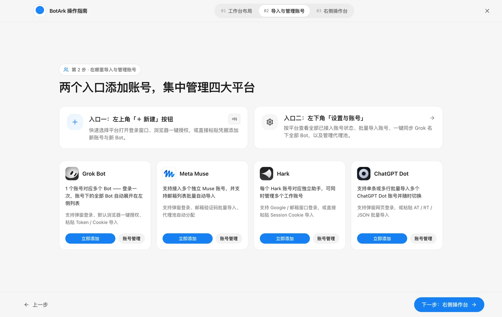

<div align="center">


# BotArk

**把你所有的 Personal Agent，收进同一艘原生桌面方舟。**

在一个清爽的 macOS / Windows 原生窗口里并排使用 **Grok Bot**、**ChatGPT Dot**、**Meta Muse** 与 **Hark** —— 支持多账号独立在线、Grok 单号多 Bot 自动展开，以及像 Grok Bot 一样顺手的右侧操作台。

<p>
  <a href="https://github.com/qybaihe/botark/releases/latest"></a>
  <a href="https://github.com/qybaihe/botark/releases/latest"></a>
  <a href="https://github.com/qybaihe/botark/releases/latest"></a>
  <a href="https://github.com/qybaihe/botark/actions/workflows/ci.yml"></a>
  <a href="../../LICENSE"></a>
</p>

<h4>
  <a href="https://github.com/qybaihe/botark/releases/latest">🍎 下载 macOS 版 (Apple 芯片)</a>
  &nbsp;·&nbsp;
  <a href="https://github.com/qybaihe/botark/releases/latest">💻 下载 macOS 版 (Intel)</a>
  &nbsp;·&nbsp;
  <a href="https://github.com/qybaihe/botark/releases/latest">🪟 下载 Windows 版</a>
  &nbsp;·&nbsp;
  <a href="https://github.com/qybaihe/botark/discussions">💬 社区讨论</a>
</h4>

<sub>
  <a href="../../README.md">English</a> ·
  <b>简体中文</b> ·
  <a href="README_zh-TW.md">繁體中文</a> ·
  <a href="README_ja.md">日本語</a> ·
  <a href="README_ko.md">한국어</a> ·
  <a href="README_es.md">Español</a> ·
  <a href="README_fr.md">Français</a> ·
  <a href="README_de.md">Deutsch</a> ·
  <a href="README_pt-BR.md">Português</a> ·
  <a href="README_ru.md">Русский</a> ·
  <a href="README_it.md">Italiano</a> ·
  <a href="README_vi.md">Tiếng Việt</a> ·
  <a href="README_tr.md">Türkçe</a> ·
  <a href="README_ar.md">العربية</a> ·
  <a href="README_id.md">Indonesia</a> ·
  <a href="README_hi.md">हिन्दी</a>
</sub>

</div>

<br />

<div align="center">
  <picture>
    <source media="(prefers-color-scheme: dark)" srcset="../assets/botark-dark.webp" />
    
  </picture>
</div>

---

## ✨ 为什么选择 BotArk？

每天重度使用多家 Personal Agent、甚至同一家还有多个工作号和主力号时，桌面上很快就会塞满四五个客户端和十几个无痕浏览器窗口。**BotArk 用一个轻快、克制的原生桌面端彻底消除切换负担：**

<table>
  <tr>
    <td width="46%" valign="middle">
      <h3>🧭 四大平台聚合，两种零门槛接入入口</h3>
      <p>点击左上角 <b><code>＋</code></b> 新建按钮（<code>⌘N</code>）或打开左下角<b>「设置与账号」</b>，灵活接入所有主力平台：</p>
      <ul>
        <li><b>丝滑弹窗与浏览器一键授权</b>：自动遵循系统代理，OAuth 登录不乱跳</li>
        <li><b>全格式凭据粘贴直连</b>：支持 Access Token、Cookie、JSON 或 API Key 直接导入</li>
        <li><b>车队级批量导入</b>：支持 Meta Muse 邮箱自动收码批量导入与 ChatGPT Dot 多行批量导入</li>
      </ul>
    </td>
    <td width="54%" valign="middle">
      <picture>
        <source media="(prefers-color-scheme: dark)" srcset="../assets/feature-platforms-dark.webp" />
        
      </picture>
    </td>
  </tr>
  <tr>
    <td width="54%" valign="middle">
      <picture>
        <source media="(prefers-color-scheme: dark)" srcset="../assets/feature-accounts-dark.webp" />
        
      </picture>
    </td>
    <td width="46%" valign="middle">
      <h3>👥 多账号并行不串号 &amp; 单号多 Bot 自动展开</h3>
      <p>工作号、个人号、测试号同时在线，会话完全独立互不干扰：</p>
      <ul>
        <li><b>Grok 单号自动展开全部 Bot</b>：登录 1 个 Grok 账号，名下所有专业 Bot 与群聊房间自动逐个出现在左侧列表，并可直接新建专属 Bot</li>
        <li><b>独立沙盒分区隔离</b>：每个账号运行在独立 Chromium 会话分区，凭据由系统钥匙串加密存储</li>
        <li><b>一号一代理防泄漏</b>：支持批量导入 <code>SOCKS5</code> / <code>HTTP</code> 代理池一对一绑定，代理异常自动阻断绝不裸连暴露真实 IP</li>
      </ul>
    </td>
  </tr>
</table>

<table>
  <tr>
    <td width="33%" valign="top">
      <h4>🗂️ 左侧以 Bot 为单位统一分组</h4>
      打破平台边界，按「日常助理 / 研究写作 / 开发运维」自由分组与置顶，按 <code>⌘K</code> 秒搜并瞬间切换对话。
    </td>
    <td width="33%" valign="top">
      <h4>🛠️ 右侧专属操作台（<code>⌘I</code>）</h4>
      保持中间聊天视野清爽；需要查看后台子任务、编辑长期记忆与技能、管理定时任务或下载云沙盒文件时，随时展开右侧面板。
    </td>
    <td width="34%" valign="top">
      <h4>🔒 纯本地存储，零遥测上传</h4>
      无任何中转服务器与统计埋点。所有会话与凭据仅保存在你自己的电脑本机，调用 macOS Keychain / Windows DPAPI 保护。
    </td>
  </tr>
</table>

---

## 🤖 支持的智能体平台

右侧操作台（`⌘I`）会根据不同平台的真实原生能力自动切换专属面板，拒绝千篇一律的空壳菜单：

| 平台 | 登录与凭据导入方式 | 左侧列表展示逻辑 | 右侧专属操作台能力（`⌘I`） |
| :--- | :--- | :--- | :--- |
|  **Grok Bot** | 弹窗直连登录、**默认浏览器一键授权**，或粘贴 Token / Cookie / JSON / API Key | **1 个账号 → 多个 Bot**：自动同步账号下全部 Bot 与群聊房间；可在已有账号下直接新建 Bot | 历史会话、后台子任务进度、自动化触发器、记忆与技能编辑、生成文件库、云端沙盒终端、MCP 连接器与配方导入导出 |
|  **Meta Muse** | 独立窗口登录，或**邮箱列表批量自动收码导入** | 1 个账号对应 1 个独立 Muse 助手（支持十几个账号并行） | 账号额度监控、操作审批确认、多会话切换、定时计划任务、目标设定、记忆与技能、工作区文件预览与云电脑控制 |
|  **ChatGPT Dot** | 网页弹窗登录，或**单条 / 多行批量粘贴 AT、RT、JSON 导入** | 1 个账号对应 1 个 Dot 助手（自带 Refresh Token 自动续期） | Orbit 角色切换、Dot / Native 双模式切换、核心目标编辑、**换号一键迁移目标与记忆**、Pages 页面与文件库浏览 |
|  **Hark** | Google / 邮箱窗口登录，或**直接粘贴 Session Cookie 导入** | 1 个账号对应 1 个 Hark 助手 | 快捷工作流卡片、历史会话切换、定时巡检任务、生成资料库下载、云端浏览器实时画面与工作区连接器 |

---

## ⚡ 30 秒快速上手

### 1. 下载直接安装

前往 [**GitHub Releases 最新版本**](https://github.com/qybaihe/botark/releases/latest) 下载对应系统的安装包：

| 操作系统 | 安装包文件 | 说明 |
| :--- | :--- | :--- |
| **macOS（Apple 芯片 M1–M4）** | `BotArk-<版本号>-arm64.dmg` | ✅ **Apple Developer ID 官方签名与公证**，拖入「应用程序」双击直开，无拦截提示 |
| **macOS（Intel 芯片）** | `BotArk-<版本号>-x64.dmg` | ✅ **Apple Developer ID 官方签名与公证**，直接打开即可使用 |
| **Windows 10 / 11（64 位）** | `BotArk-Setup-<版本号>-x64.exe` | 一键安装向导（升级或卸载自动保留本地账号数据） |

### 2. 导入账号并开始对话

1. 点击侧边栏左上角 **`＋`（`⌘N` / `Ctrl+N`）** 快速添加账号，或打开左下角 **「设置与账号」** 批量导入与分配代理。
2. 点击左侧任意 Bot 即可开始流式对话、发送文件或审批动作；按 **`⌘I` / `Ctrl+I`** 随时开关右侧专属操作台。

> [!TIP]
> 随时点击侧边栏左下角的 **✦ 星标按钮**，即可呼出内置的 **全屏交互式操作指南**，分步查看工作台布局、导入入口与各平台面板说明。

---

## ⌨️ 常用快捷键

| 快捷键（macOS / Windows） | 功能说明 |
| :--- | :--- |
| `⌘K` / `Ctrl+K` | **全局指令面板** —— 秒搜 Bot、分组、历史消息与快捷指令 |
| `⌘N` / `Ctrl+N` | 新建 Bot 或接入新平台账号 |
| `⌘I` / `Ctrl+I` | 展开 / 收起当前 Bot 的右侧专属操作台 |
| `⌘[` · `⌘]` / `Ctrl+[` · `Ctrl+]` | 快速切换到侧边栏上一个 / 下一个 Bot |

---

## 🧰 本地开发

环境要求：**Node.js 22.19+**（推荐 Node 24，详见 [`.nvmrc`](../../.nvmrc)）。

```bash
git clone https://github.com/qybaihe/botark.git
cd botark
npm ci
npm run dev          # 启动 Electron + Vite 热更新开发环境
```

| 命令 | 说明 |
| :--- | :--- |
| `npm run dev` | 启动主进程、Preload 与 React 界面（支持热更新） |
| `npm run typecheck` | 运行 Node 与前端双端 TypeScript 类型检查 |
| `npm test` | 运行 Vitest 单元测试套件 |
| `npm run build` | 类型检查并构建生产产物至 `out/` |
| `npm run dist:dir` | 快速打包 macOS `arm64` 本地测试版应用至 `release/` |
| `npm run dist:mac` / `npm run dist:win` | 打包正式 macOS `.dmg` + `.zip` 或 Windows `.exe` 安装包 |

想参与贡献或接入新的 Agent 平台？欢迎阅读 [**贡献指南 (CONTRIBUTING.md)**](../../CONTRIBUTING.md) 以及 [**`docs/` 协议参考目录**](../README.md)。

---

## ❓ 常见问题

<details>
<summary><b>BotArk 是这些平台的官方客户端吗？</b></summary>

不是。BotArk 是基于 MIT 协议开源的独立桌面客户端，与 xAI、OpenAI、Meta、Hark 均无隶属关系。你使用自己的账号登录，所有请求由你的电脑直接与对应平台通信。

</details>

<details>
<summary><b>macOS 安装打开时会提示「无法验证开发者」或被拦截吗？</b></summary>

不会。官方发布的 macOS `.dmg` 安装包均已通过 **Apple Developer ID 签名与苹果官方公证（Notarized）**，拖入「应用程序」即可直接双击打开。

</details>

<details>
<summary><b>Grok Bot 的「一个账号对应多个 Bot」是怎么管理的？</b></summary>

在 Grok Bot 中，一个账号名下可以创建多个不同职责的 Bot 和群聊房间。你在 BotArk 登录或导入一次 Grok 账号后，名下全部 Bot 会自动作为独立条目出现在左侧对话列表中。从左侧删除某个 Bot 只会在本地隐藏它，不会退出整个账号；随时点击「同步全部 Bot」即可恢复完整列表。

</details>

<details>
<summary><b>我的账号凭据保存在哪里？旧版升级会丢数据吗？</b></summary>

所有会话与凭据仅保存在你自己的电脑本地（macOS 位于 `~/Library/Application Support/botark`，Windows 位于 `%APPDATA%\botark`），如果检测到本机已有旧版 `bothub` 数据目录会自动无缝继承，零账号丢失。

</details>

---

## 📈 Star 增长趋势

<div align="center">
  <a href="https://star-history.com/#qybaihe/botark&Date">
    <picture>
      <source media="(prefers-color-scheme: dark)" srcset="https://api.star-history.com/svg?repos=qybaihe/botark&type=Date&theme=dark" />
      
    </picture>
  </a>
</div>

---

<div align="center">
  基于 <a href="../../LICENSE"><b>MIT 许可证</b></a> 开源。<br />
  <sub>如果 <b>BotArk</b> 帮你的桌面省下了十几个浏览器窗口，欢迎点亮右上角的 <b>⭐ Star</b> 支持我们！</sub>
</div>
