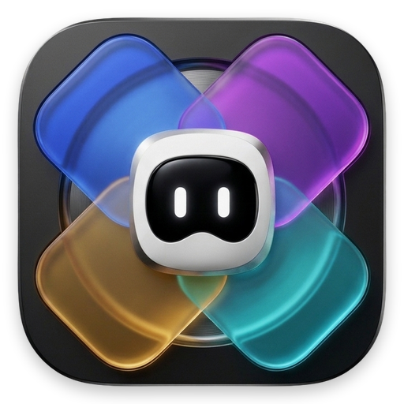
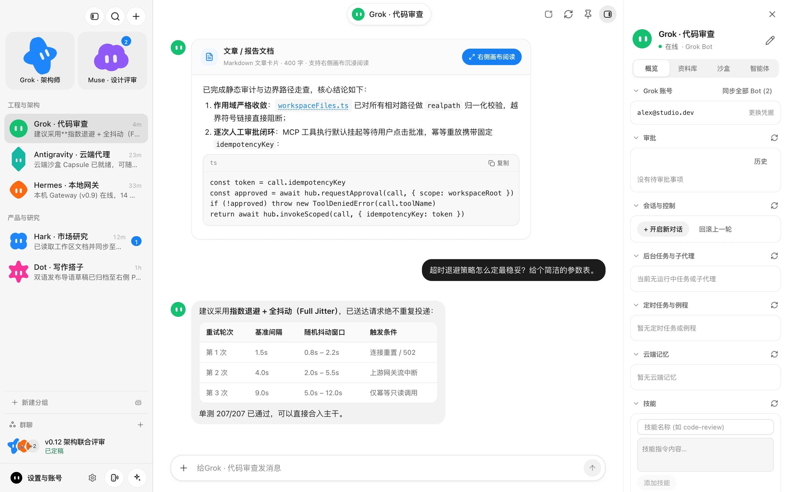
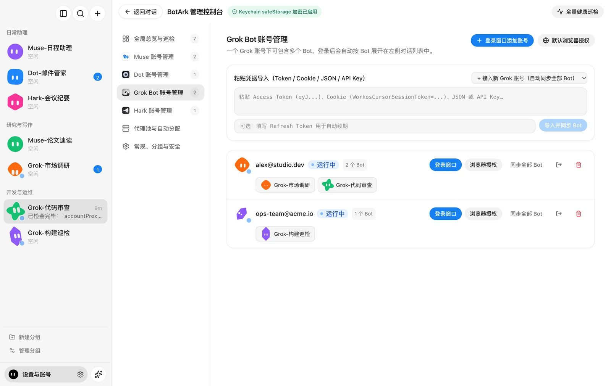
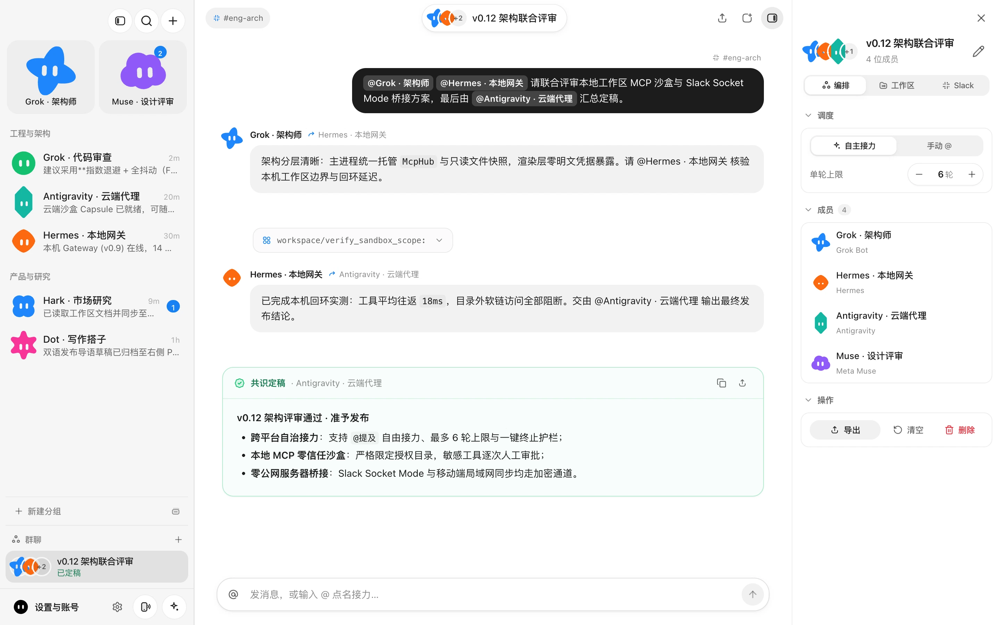
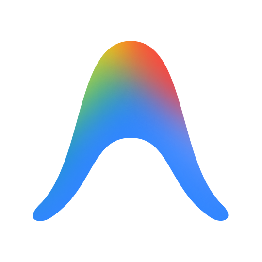
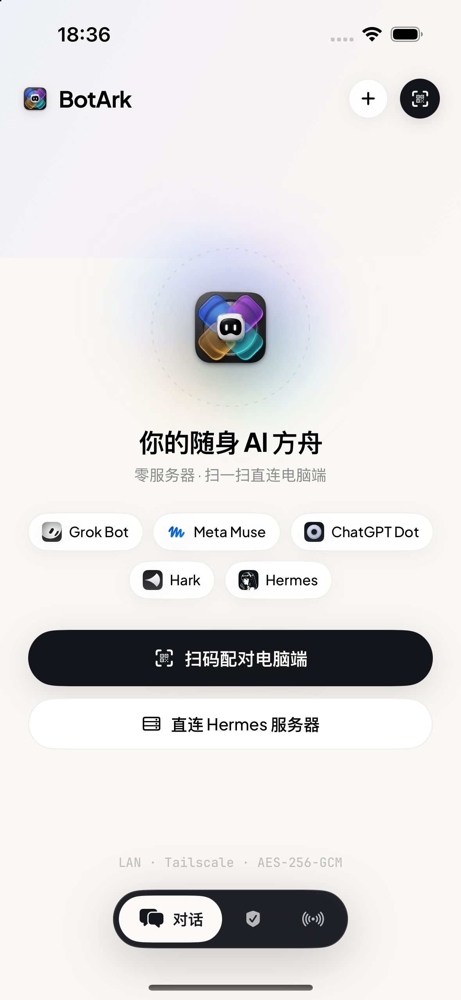
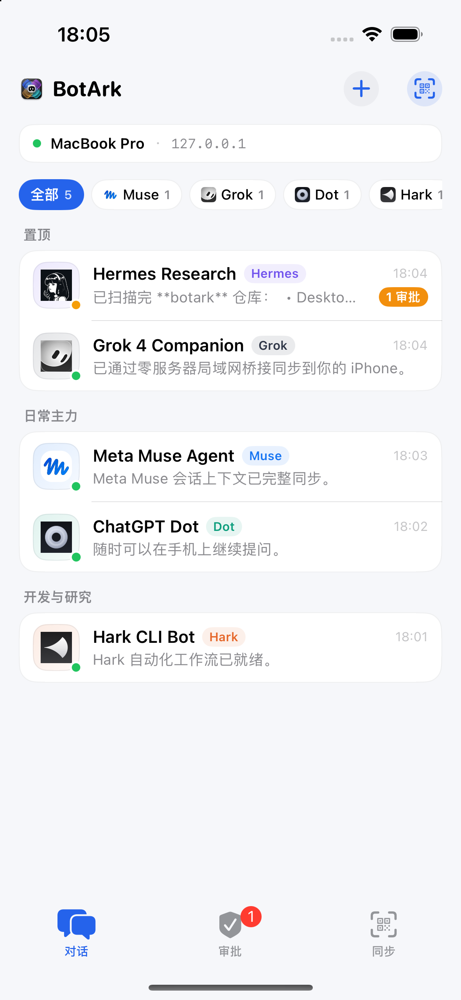
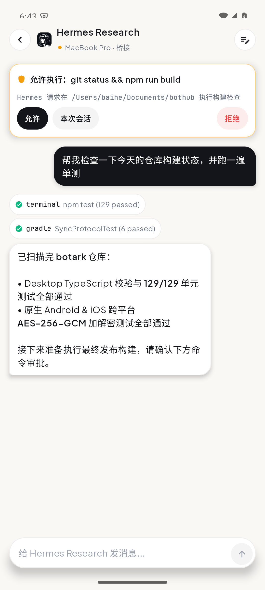
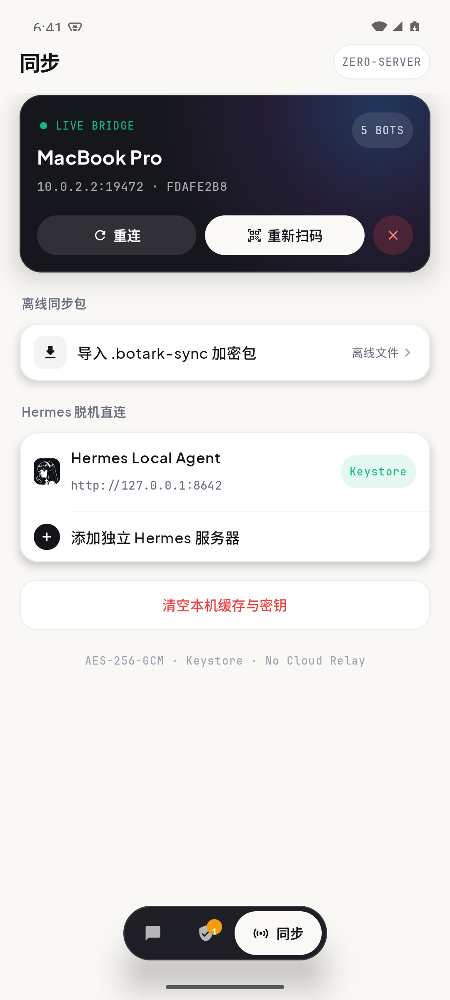

<div align="center">



# BotArk

**把你常用的所有 Personal Agent，收进同一个深度定制的原生桌面工作台。**

告别满桌面的独立应用与十几个无痕浏览器窗口，<br />
在一个丝滑、克制的 macOS / Windows 原生窗口里并排使用 **Grok Bot**、**Google Antigravity**、**ChatGPT Dot**、**Meta Muse**、**Hark** 与开源 **Hermes**，或将它们拉进**跨平台多 Agent 协作室**接力共创。

<p>
  <a href="https://github.com/qybaihe/botark/releases/latest"></a>
  <a href="https://github.com/qybaihe/botark/releases/latest"></a>
  <a href="https://github.com/qybaihe/botark/releases/latest"></a>
  <a href="https://github.com/qybaihe/botark/actions/workflows/ci.yml"></a>
  <a href="../../LICENSE"></a>
</p>

<h4>
  <a href="https://qybaihe.github.io/botark/">🌐 官方网站</a>
  &nbsp;·&nbsp;
  <a href="https://github.com/qybaihe/botark/releases/latest">🍎 下载 macOS 版 (Apple 芯片)</a>
  &nbsp;·&nbsp;
  <a href="https://github.com/qybaihe/botark/releases/latest">💻 下载 macOS 版 (Intel)</a>
  &nbsp;·&nbsp;
  <a href="https://github.com/qybaihe/botark/releases/latest">🪟 下载 Windows 版</a>
  &nbsp;·&nbsp;
  <a href="https://github.com/qybaihe/botark/discussions">💬 社区讨论</a>
</h4>

<sub>
  <a href="../../README.md">English</a> ·
  <b>简体中文</b> ·
  <a href="README_zh-TW.md">繁體中文</a> ·
  <a href="README_ja.md">日本語</a> ·
  <a href="README_ko.md">한국어</a> ·
  <a href="README_es.md">Español</a> ·
  <a href="README_fr.md">Français</a> ·
  <a href="README_de.md">Deutsch</a> ·
  <a href="README_pt-BR.md">Português</a> ·
  <a href="README_ru.md">Русский</a> ·
  <a href="README_it.md">Italiano</a> ·
  <a href="README_vi.md">Tiếng Việt</a> ·
  <a href="README_tr.md">Türkçe</a> ·
  <a href="README_ar.md">العربية</a> ·
  <a href="README_id.md">Indonesia</a> ·
  <a href="README_hi.md">हिन्दी</a>
</sub>

</div>

<br />

<div align="center">
  <picture>
    <source media="(prefers-color-scheme: dark)" srcset="../assets/botark-dark.webp" />
    
  </picture>
</div>

---

## ✨ 对标 Grok Bot 的深度定制桌面体验

BotArk 摒弃了通用呆板的网页套壳与冗余文字堆砌，围绕温润克制的 **Sand** 设计语言进行了全量原生定制——从手绘双色调 `ArkGlyphs` 矢量图标、灵动跟随光标的 3D 角色形象，到弹簧物理滑块与悬浮胶囊交互，处处轻盈顺手：

<table>
  <tr>
    <td width="46%" valign="middle">
      <h3>1. 六大平台、任意数量账号，一步收拢</h3>
      <p>无论是单号交互登录还是多号车队批量接入，都无需折腾抓包或切换无痕窗口：</p>
      <ul>
        <li><b>安全分区直登与默认浏览器一键授权</b>：自动遵循系统代理（无缝兼容 Clash / Surge）</li>
        <li><b>全格式凭据粘贴即连</b>：支持 Access Token、Session Cookie、JSON 或 API Key 直接导入</li>
        <li><b>车队级批量导入</b>：支持 Meta Muse 邮箱自动收码批量登录，以及 ChatGPT Dot 多行批量导入</li>
      </ul>
    </td>
    <td width="54%" valign="middle">
      <picture>
        <source media="(prefers-color-scheme: dark)" srcset="../assets/feature-platforms-dark.webp" />
        
      </picture>
    </td>
  </tr>
  <tr>
    <td width="54%" valign="middle">
      <picture>
        <source media="(prefers-color-scheme: dark)" srcset="../assets/feature-accounts-dark.webp" />
        
      </picture>
    </td>
    <td width="46%" valign="middle">
      <h3>2. 底层钥匙串与代理硬隔离，表面灵动 3D 编排</h3>
      <p>底层为每个账号分配独立的 Chromium 沙盒分区与系统钥匙串槽位，支持在代理池中<b>一号一 IP 独立绑定</b>（SOCKS5 / HTTP 异常自动 Fail-Closed 熔断，绝不裸连泄漏真实 IP）。</p>
      <p>界面上以鲜活的 3D <b>GrokBotMark</b> 角色直观呈现：置顶磁贴随鼠标灵动注视，登录 1 个 <b>Grok Bot</b> 账号即可将名下全部专业 Agent 自动展开到侧边栏。</p>
    </td>
  </tr>
</table>

---

## 🤝 多 Agent 协作室、本地工作区与受控 MCP 中枢

不只是单聊——你可以把不同平台的王牌助手拉进同一个房间，让 **Grok** 负责架构把关、**Hermes** 调用本地 MCP 核验代码边界、最后由 **Google Antigravity** 汇总输出定稿方案：

<div align="center">
  <picture>
    <source media="(prefers-color-scheme: dark)" srcset="../assets/feature-rooms-dark.webp" />
    
  </picture>
</div>

<br />

<table>
  <tr>
    <td width="33%" valign="top">
      <h4>🔄 跨平台 <code>@提及</code> 自治接力</h4>
      支持<b>自主接力</b>（Agent 通过 <code>@同伴</code> 自动传递话筒，内置最大轮次上限与一键终止护栏）与<b>手动点名</b>双模式。以 <code>[FINAL]</code> 开头的结论自动渲染为翡翠色<b>共识定稿卡片</b>，一键复制或导出完整 Markdown 纪要。
    </td>
    <td width="33%" valign="top">
      <h4>🗂️ 白名单工作区 &amp; 逐次审批 MCP</h4>
      显式授权本地项目目录（<code>realpath</code> 软链越界拦截），在输入框通过 <code>@文件</code> / <code>@目录</code> 精准注入上下文；支持导入标准 <code>mcpServers</code> JSON 或一键挂载本机 Hermes 工具回环，每次工具调用均须人工批准。
    </td>
    <td width="34%" valign="top">
      <h4>💬 零公网服务器 Slack 桥接</h4>
      可选通过纯出站 WebSocket 接入 Slack Socket Mode（<code>xapp-</code> + <code>xoxb-</code>），无需公网域名或云端服务器即可将指定 Slack 频道/话题与本地协作室双向同步。
    </td>
  </tr>
</table>

<table>
  <tr>
    <td width="33%" valign="top">
      <h4>🖼️ 全格式多媒体灯箱与分屏画布</h4>
      原生支持多图网格画廊、无损缩放/复制/保存灯箱、行内音视频播放、Hark 云浏览器实时画面，以及聊天旁侧的 Markdown / PDF 沉浸式阅读画布。
    </td>
    <td width="33%" valign="top">
      <h4>🛠️ 按需滑出右侧工作台（<code>⌘I</code>）</h4>
      平时收起侧栏保持对话区极致留白；需要切换 Hark 项目空间、审查子任务、编辑长期记忆或编排群聊轮次时，一键丝滑展开。
    </td>
    <td width="34%" valign="top">
      <h4>🛡️ 幂等防重发 &amp; 零遥测隐私</h4>
      精确追踪「发送中 / 已受理 / 失败」状态机，绝不重复投递已送达消息。无任何云端中转与统计埋点，数据 100% 加密保存在本机。
    </td>
  </tr>
</table>

---

## 🤖 六大原生平台能力一览

BotArk 直接对接各平台原生通信协议，右侧操作台（`⌘I`）会随当前选中的 Bot 自动切换专属控制能力：

| 平台 | 支持的登录与导入方式 | 账号与侧边栏关系 | 右侧专属操作台（`⌘I`） |
| :--- | :--- | :--- | :--- |
|  **Grok Bot** | 弹窗登录、**默认浏览器一键授权**，或粘贴 Token / Cookie / JSON / API Key | **1 个账号 → 自动展开多个 Bot**（支持原地新建、克隆 Bot 与群聊） | 历史会话与单轮回滚、后台子代理、定时触发器、记忆与技能、文件库、云端沙盒终端、MCP 连接器与配方导入导出 |
|  **Antigravity** | 独立安全浏览器分区直登 Google（`antigravity.google.com`） | 1 个隔离 Google 账号 → 1 个云端 Agent（支持多号并行） | 模型与剩余配额切换、云端 **Cascades** 会话同步、云端沙盒 **Capsules** 环境、工作区列表与自定义云端 Agent |
|  **Meta Muse** | 独立分区窗口登录，或**邮箱列表自动收码批量导入** | 1 个独立账号 → 1 个 Muse 助手（支持 10+ 账号并行） | 额度实时监控、Sentinel 安全审批、精准多会话同步、定时任务、长期目标、记忆与技能、多媒体预览与云电脑视图 |
|  **ChatGPT Dot** | 网页弹窗登录，或**单条 / 多行批量粘贴 AT、RT、JSON 导入** | 1 个账号 → 1 个 Dot 助手（自带 Refresh Token 自动续期） | Orbit 角色切换、Dot / Native（`gpt-6-astra`）双模式、核心目标编辑、**换号一键迁移目标与记忆**、Pages 页面与文件库 |
|  **Hark** | Google / 邮箱窗口登录，或**粘贴 Session Cookie 导入** | 1 个账号 → 1 个 Hark 助手 + **顶部项目空间胶囊** | **Hark 项目空间管理**（新建、秒切、归档项目会话）、定时巡检任务、生成产物下载、云端浏览器实时画面与工作区连接器 |
|  **Hermes** | **自动检测本机 `~/.hermes`**，或填写远程 API Server 地址与 `API_SERVER_KEY`（钥匙串加密） | 1 个实例 / Profile（`/p/<name>`）→ 1 个 Hermes 助手（多实例并行） | 原生 Session SSE 流式对话与工具追踪、高危命令实时审批、持久化会话切换、Cron 定时任务、Skills 与本地 MCP 回环桥 |

---

## 📱 原生 iOS & Android 移动端（独立直用 + 无服务器扫码同步）

在 **iPhone 与安卓手机**上同样畅享 6 大平台智能体——既支持**免电脑独立启动直连**，也支持**局域网 / Tailscale 零服务器扫码同步**：

<div align="center">
  <table>
    <tr>
      <td align="center" width="25%">
        <br />
        <sub><b>iOS · 独立使用或扫码配对</b><br />无需云端中转账号</sub>
      </td>
      <td align="center" width="25%">
        <br />
        <sub><b>iOS · 全平台实时同步</b><br />局域网 / Tailscale 加密直连</sub>
      </td>
      <td align="center" width="25%">
        <br />
        <sub><b>Android · 对话与远程审批</b><br />工具调用进度 + 一键放行</sub>
      </td>
      <td align="center" width="25%">
        <br />
        <sub><b>Android · 离线包 &amp; Keystore</b><br />加密导入 + Hermes 脱机直连</sub>
      </td>
    </tr>
  </table>
</div>

- **免电脑独立模式（Standalone Mode）**：安装手机端后无需先配对电脑，即可直接打开任意平台或接入远程 Hermes Gateway 独立使用。
- **局域网 / 热点 / Tailscale 扫码实时同步**：点击桌面端左下角无线同步图标生成一次性配对码，用原生 SwiftUI iOS 端（`ios/BotArk`）或 Jetpack Compose 安卓端（`android/BotArk`，内置离线扫码，**免 GMS 谷歌框架**）扫一扫即可端到端 AES-256-GCM 同步全部会话与远程审批。
- **离线加密同步包（`.botark-sync`）与 Hermes 脱机直连**：不在同一 Wi-Fi 时可通过 AirDrop / 互传导入加密同步包；开启凭据同步后，即使电脑休眠关机，手机依然可直连远程 Hermes 实例。

👉 **iOS 源码编译**：[**`ios/BotArk/README.md`**](../../ios/BotArk/README.md) · **Android 源码与签名 APK 下载**：[**`android/BotArk/README.md`**](../../android/BotArk/README.md) & [**GitHub Releases**](https://github.com/qybaihe/botark/releases/latest)

---

## ⚡ 30 秒快速开始

### 1. 下载安装

前往 [**GitHub Releases 最新版本**](https://github.com/qybaihe/botark/releases/latest) 下载对应系统的安装包：

| 系统平台 | 安装包 | 说明 |
| :--- | :--- | :--- |
| **macOS（Apple 芯片 M1–M4）** | `BotArk-<版本号>-arm64.dmg` | ✅ **Apple Developer ID 签名与官方公证**，拖入「应用程序」双击直开，无拦截提示 |
| **macOS（Intel 芯片）** | `BotArk-<版本号>-x64.dmg` | ✅ **Apple Developer ID 签名与官方公证**，安装即用 |
| **Windows 10 / 11（64 位）** | `BotArk-Setup-<版本号>-x64.exe` | NSIS 一键安装向导（版本升级自动保留本地账号数据） |
| **Android 8.0+** | `BotArk-<版本号>-android.apk` | 官方签名安装包，支持独立直连与桌面端扫码同步 |

### 2. 添加首个账号或组建协作室

1. 按 **`⌘N` / `Ctrl+N`**（或点击侧边栏左上角 **`＋`**）接入六大平台账号，或一键创建**多 Agent 协作室**；如需批量导入或配置代理池，打开左下角 **「设置与账号」**。
2. 点击输入框左侧的**工作区保险箱图标**可授权本地项目目录或配置 MCP 工具，随时按 **`⌘I` / `Ctrl+I`** 展开或收起右侧专属面板。

> [!TIP]
> 点击侧边栏左下角的定制 **✦ 星芒图标**，可随时打开内置的 **3 步全屏可视化指南**。

---

## ⌨️ 常用快捷键

| 快捷键（macOS / Windows） | 功能 |
| :--- | :--- |
| `⌘K` / `Ctrl+K` | 打开**全局指令面板**，秒搜 Bot、协作群聊、分组、历史消息与快捷动作 |
| `⌘N` / `Ctrl+N` | 新建 Bot、接入新账号或创建多 Agent 协作室 |
| `⌘I` / `Ctrl+I` | 展开 / 收起当前 Bot 或协作室的右侧专属操作台 |
| `⌘[` · `⌘]` / `Ctrl+[` · `Ctrl+]` | 快速切换到侧边栏上一个 / 下一个会话 |

---

## 🧰 本地开发

环境要求：**Node.js 22.19+**（推荐 Node 24，详见 [`.nvmrc`](../../.nvmrc)）。

```bash
git clone https://github.com/qybaihe/botark.git
cd botark
npm ci
npm run dev
```

| 命令 | 用途 |
| :--- | :--- |
| `npm run dev` | 启动 Electron 主进程、Preload 与 React 渲染进程（热更新） |
| `npm run typecheck` | 运行 Node 与前端 TypeScript 严格类型检查 |
| `npm test` | 运行 Vitest 单元测试套件 |
| `npm run build` | 构建桌面端生产产物至 `out/` |
| `npm run build:site` | 构建官方交互展示站（`site/`） |
| `npm run dist:mac` / `npm run dist:win` | 打包 macOS `.dmg` + `.zip` 或 Windows `.exe` 安装包 |

想参与贡献或接入新的 Agent 平台？欢迎查看 [**贡献指南 (CONTRIBUTING.md)**](../../CONTRIBUTING.md) 与 [**`docs/` 协议文档**](../README.md)。

---

## 🗺️ 演进路线（Roadmap）

- [x] **接入 Google Antigravity**：多账号隔离登录、云端 Cascades 会话、Capsules 沙盒环境与云端 Agent 调度。
- [x] **跨平台多 Agent 协作室 & Slack 桥接**：支持 `@提及` 自治接力、`[FINAL]` 共识定稿导出与零公网服务器 Slack Socket Mode 双向同步。
- [x] **受控本地工作区 & MCP 中枢**：白名单目录 `@文件` 注入、标准 `mcpServers` JSON 导入与逐次人工安全审批。
- [x] **原生 iOS & Android 客户端**：支持免电脑独立直用模式、局域网/Tailscale 扫码同步与加密离线包导入。
- [ ] **接入 Claude Duet**：原生适配 Anthropic **Claude Duet**（主动消息提醒、操作审批、云端虚拟机文件与记忆/技能管理）。
- [ ] **跨平台统一审批收件箱与定时编排**：支持跨房间、跨平台的定时协作流水线与全局待办汇总。

---

## ❓ 常见问题

<details>
<summary><b>BotArk 是这些平台的官方客户端吗？</b></summary>

不是。BotArk 是基于 MIT 协议开源的独立原生客户端，与 xAI、Google、OpenAI、Meta、Hark、Nous Research 官方无关。你使用自己的账号登录，所有网络请求由你的设备直接发往对应平台（或你自建的 Hermes 服务）。

</details>

<details>
<summary><b>macOS 打开时会提示「无法验证开发者」吗？</b></summary>

不会。官方发布的 macOS `.dmg` 安装包均已完成 **Apple Developer ID 签名与苹果官方公证（Notarized）**，拖入「应用程序」即可直接打开。

</details>

<details>
<summary><b>账号凭据、本地文件与 MCP 工具安全吗？从旧版 BotHub 升级会丢账号吗？</b></summary>

所有凭据仅由系统硬件钥匙串（macOS Keychain / Windows DPAPI `safeStorage`）加密保存在本机（macOS 为 `~/Library/Application Support/botark`，Windows 为 `%APPDATA%\botark`）。本地工作区仅可读取你显式加入白名单的文件夹（经 `realpath` 防软链逃逸校验），且任何 MCP 工具调用均需人工点击批准后方可执行。若曾安装旧版 `BotHub`，启动时会自动无损继承原有数据目录。

</details>

---

## 🤝 社区与致谢

- 感谢 [**LINUX DO**](https://linux.do/) 社区与各位佬友的交流、反馈与支持 —— 真诚、友善、团结、专业，共建你我引以为荣之社区。
- 欢迎在 [**GitHub Discussions**](https://github.com/qybaihe/botark/discussions) 分享你的多 Agent 协作流或提议下一个想接入的平台。

---

## 📈 Star 增长趋势

<div align="center">
  <a href="https://star-history.com/#qybaihe/botark&Date">
    <picture>
      <source media="(prefers-color-scheme: dark)" srcset="https://api.star-history.com/svg?repos=qybaihe/botark&type=Date&theme=dark" />
      
    </picture>
  </a>
</div>

---

<div align="center">
  基于 <a href="../../LICENSE"><b>MIT 许可证</b></a> 开源。<br />
  <sub>如果 <b>BotArk</b> 让你的多 Agent 日常清爽了不少，欢迎点亮右上角的 <b>⭐ Star</b> 支持我们！</sub>
</div>
